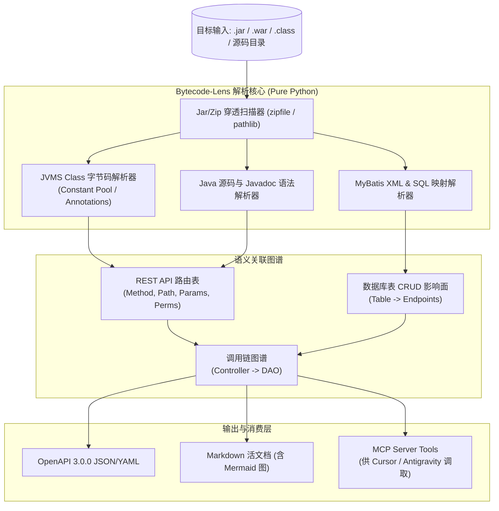

# Bytecode-Lens (字节码透镜)
### —— 面向企业老旧 Java 系统 (Jar/Class/源码) 的零依赖接口与表链路逆向工程智能体

> **版本**：v1.0.0  
> **核心定位**：Pure-Python Java 字节码与源码静态分析器 + MCP 开发者智能体  
> **适用场景**：致远协同客开插件、用友 NC/NCC 补丁包、若依/芋道体系及老旧 Spring MVC/Boot 系统  
> **技术特色**：**无需本地安装 JDK / JRE / javap**，纯 Python 极速解析 JVMS 字节码与 MyBatis 映射

---

## 1. Problem Statement (问题陈述)

> **How Might We** 在**不依赖本地 JDK 环境、面对仅有 Jar 包或混乱无文档的老旧 Java 系统**时，秒级逆向推导出完整的 REST 接口规范（OpenAPI 3.0）、权限控制矩阵及数据库表（CRUD）访问调用链，为企业二开与 AI 编码助手提供精准活文档？

---

## 2. 核心能力与技术亮点

1. **纯 Python JVMS 字节码解析器（Zero JDK Dependency）**
   - 传统反编译工具通常依赖 Java 运行时（如 CFR、Fernflower、Javap）。
   - Bytecode-Lens 采用纯 Python 实现的标准 JVM Class 文件格式规范（支持 Java 8、11、17、21），直接解析 Constant Pool、Attributes、Method Signatures 及 `RuntimeVisibleAnnotations`，单线程解析 1000 个 Class 文件仅需毫秒级。

2. **双模态扫描（Dual Mode Scanning）**
   - **字节码模式**：直接穿透扫描 `.jar`、`.war`、`.class` 二进制包；
   - **源码模式**：直接扫描 `.java` 源码树与 Javadoc 注释，提取更丰富的方法注释、参数命名与语义信息。

3. **接口与数据库表穿透关联（Controller -> Service -> Mapper -> Table）**
   - 不仅扫描 `@GetMapping` / `@PostMapping` / `@RequestMapping`，还能深度扫描 MyBatis `*Mapper.xml` 与注解 SQL，自动建立“哪个 API 读写了哪张数据库表”的完整影响面图谱。

4. **安全与权限矩阵自动抽取**
   - 自动识别 Spring Security (`@PreAuthorize`)、Shiro (`@RequiresPermissions`) 及自定义企业鉴权注解，输出清晰的权限编码字典。

5. **标准契约导出与 MCP 原语**
   - 一键导出标准 **OpenAPI 3.0.0** (Swagger JSON/YAML)；
   - 一键生成带有 Mermaid 拓扑图的 Markdown Living Spec；
   - 作为 MCP Server 挂载到 AI IDE (Cursor / Antigravity / Windsurf)，让 AI 具备直接感知老系统接口结构的能力。

---

## 3. 架构拓扑 (Architecture)

---

## 4. MCP Tools 规格定义

| Tool 原语 | 功能描述 |
| :--- | :--- |
| `scan_java_target` | 扫描指定的 Jar 包文件或源码工程目录，提取路由与数据流总览 |
| `list_endpoints` | 按模块、HTTP 方法或关键字检索 API 路由清单 |
| `get_endpoint_detail` | 查看具体路由的入参、返回值类型、所需权限及调用的数据库表 |
| `find_table_usage` | **逆向影响面分析**：查询特定数据库表被哪些 Controller / API 接口读写 |
| `export_spec` | 将整个扫描结果导出为标准 OpenAPI 3.0 规范或 Markdown 文档 |
